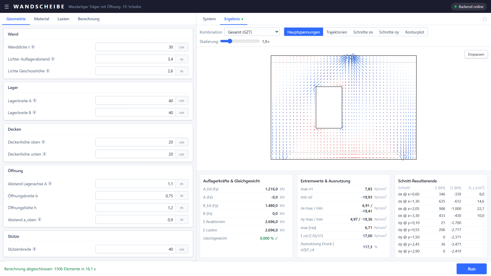
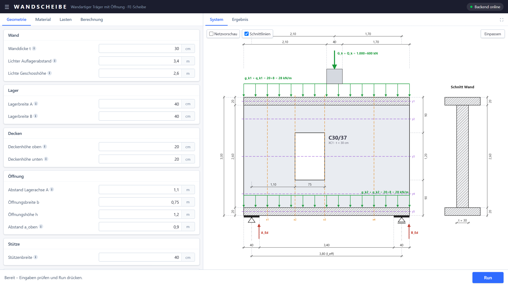

# Wandscheibe – wandartiger Träger mit Öffnung

> **Gevibecoded für einen Vortrag an der Technischen Hochschule Würzburg-Schweinfurt (THWS).**
> Das Tool ist komplett per KI-gestützter Entwicklung („Vibe Coding“) mit Claude Code entstanden –
> Entwicklungsplan mit Claude Opus, Umsetzung mit Claude Sonnet.

FE-Bemessungstool für die Scheibenbeanspruchung eines wandartigen Trägers mit Öffnung:
Parametereingabe, maßstäbliche Systemskizze, FE-Berechnung mit PyNiteFEA und Darstellung von
Hauptspannungen, Trajektorien, Spannungsschnitten σx/σy, Konturplots sowie erforderlicher Bewehrung.





## Aufbau

- **Frontend:** Next.js, TypeScript, Tailwind CSS, react-konva (2D-Rendering), zustand
- **Backend:** FastAPI + [PyNiteFEA](https://github.com/JWock82/Pynite) (Scheibenmodell mit Quad-Elementen)
- **Spezifikation:** [PLAN.md](PLAN.md) – Geometrie, FE-Modell, Lastkombinationen, API-Vertrag

## Ausprobieren in GitHub Codespaces

[](https://codespaces.new/ahofbeck/wandscheibe?quickstart=1)

Codespace erstellen → Abhängigkeiten werden installiert und das Frontend gebaut (beim ersten Mal einige Minuten) →
Backend und App starten automatisch, die App öffnet sich auf Port 3000 im Browser.
Falls nicht: im Tab „Ports“ die Adresse von Port 3000 öffnen bzw. `bash .devcontainer/start.sh` ausführen.

## Start (lokal)

```powershell
pip install -r backend/requirements.txt
npm install --prefix frontend
./start.ps1
```

Dann http://localhost:3000 öffnen. Das Backend läuft auf Port 8000 (`GET /health`, `POST /analyze`).

## Start (Docker)

```bash
docker compose up --build
```

Für den lokalen Zugriff in `docker-compose.yml` beim Frontend `ports: ["3000:3000"]` ergänzen.

## Tests

```powershell
cd backend; python -m pytest
```

## Hinweis

Lehr- und Demonstrationsprojekt. Lineare Berechnung am ungerissenen Scheibenmodell, Decken vereinfacht
mit Wanddicke – die Ergebnisse ersetzen keine geprüfte statische Berechnung.
